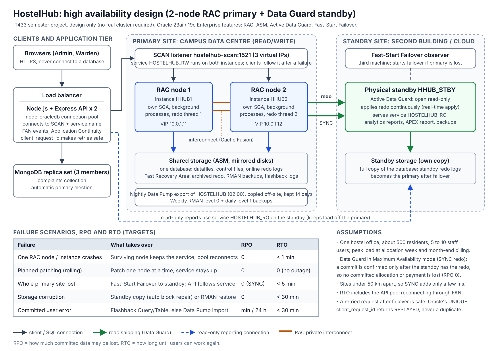

# High availability and RAC design

Requirement: *a one-page high-availability and multi-instance/RAC diagram with primary/standby, client connections, RPO and RTO assumptions. Real cluster setup is not required.*

The diagram is [`ha_rac_diagram.png`](ha_rac_diagram.png) (high resolution, for the report) and [`ha_rac_diagram.svg`](ha_rac_diagram.svg) (editable: open it in a browser, Inkscape or draw.io). Insert the PNG on its own page in the report, landscape.

## What the design does, in short (paste into the report under the diagram)

**Client connections.** Staff use a browser over HTTPS. The browser only talks to the Node.js API; it never connects to Oracle or MongoDB. Two API instances run behind a load balancer, so one can fail or be updated without an outage. Each API instance keeps a node-oracledb connection pool that connects to the **SCAN listener** (`hostelhub-scan:1521`) with the service name `HOSTELHUB_RW`, never to one server's address. The SCAN listener sends each new connection to the least busy RAC instance.

**Primary site: two-node RAC.** Two servers each run an Oracle instance (`HHUB1`, `HHUB2`) on **one shared database** stored on ASM disks. The instances share data blocks over a private interconnect (Cache Fusion). If one node fails, the other keeps serving the `HOSTELHUB_RW` service; Fast Application Notification (FAN) tells the connection pools straight away, so they drop dead connections and reconnect to the surviving node. Patches are applied one node at a time (rolling), so there is no planned downtime.

**Standby site: Data Guard.** A physical standby database (`HHUB_STBY`) in a second building or the cloud receives the redo stream from the primary and applies it continuously. Transport is **SYNC** (Maximum Availability mode): a COMMIT returns only once the standby has the redo, so a lost primary site loses no committed allocation or payment. With **Active Data Guard** the standby is open read-only, so the analytics reports and the APEX report can run there through the `HOSTELHUB_RO` service and keep that load off the primary. A **Fast-Start Failover observer** on a third machine watches both sites and promotes the standby automatically if the primary is lost; the role-based service `HOSTELHUB_RW` then starts on the new primary and the API follows it with no configuration change.

**Backups and user errors.** Neither RAC nor Data Guard protects against a committed mistake, because the bad change is copied to every instance and to the standby too. For that, HostelHub keeps Flashback (for recent mistakes) and a nightly Data Pump export (the exercise in `backup_restore.md`), plus RMAN physical backups.

**Retries during a failover.** If a node dies while the warden presses "Allocate", the browser may retry the request. Because every request carries the same `client_request_id` and Oracle enforces it as UNIQUE, the retry returns `REPLAYED` instead of creating a second allocation. This is what makes failover safe for the critical business action.

## RPO and RTO

**RPO** (Recovery Point Objective) is the most committed data we accept losing. **RTO** (Recovery Time Objective) is how long until users can work again.

| Failure | What takes over | RPO | RTO |
|---|---|---|---|
| One RAC node or instance crashes | Surviving node keeps the service; pools reconnect through FAN | 0 | under 1 minute |
| Planned patching | Rolling patch, one node at a time | 0 | no outage |
| Whole primary site lost (power, fire) | Fast-Start Failover to the standby | 0 (SYNC transport) | under 5 minutes |
| Storage corruption | Standby copy (automatic block repair) or RMAN restore | 0 | under 30 minutes |
| Committed user error (wrong DELETE) | Flashback Query / Flashback Table; else Data Pump import | minutes (flashback) or up to 24 h (last nightly export) | under 30 minutes |

## Assumptions

- One hostel office with about 500 residents and 5 to 10 staff users. Load peaks in allocation week and at month-end billing.
- The two sites are less than 50 km apart, so SYNC redo adds only a few milliseconds to each commit. If the standby were far away, ASYNC (Maximum Performance) would be used and the site-loss RPO would become a few seconds.
- RTO includes the time for the API's connection pools to reconnect.
- RAC, Active Data Guard and Fast-Start Failover need Oracle Enterprise Edition. For a small budget, the same layout works with a single-instance primary plus a Data Guard standby (RPO stays 0, node-crash RTO becomes the failover time of a few minutes).
- MongoDB (complaints) runs as a three-member replica set, which elects a new primary automatically when one member fails.
